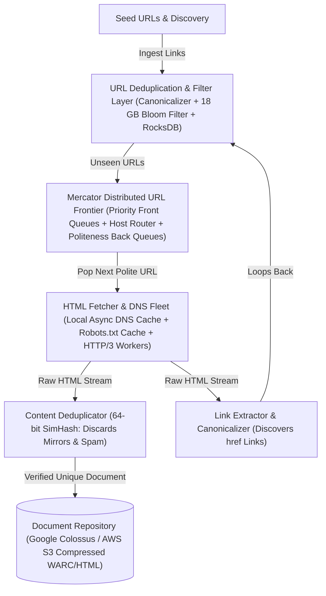
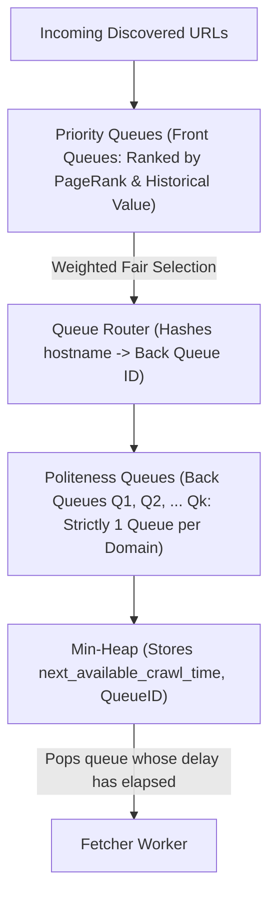
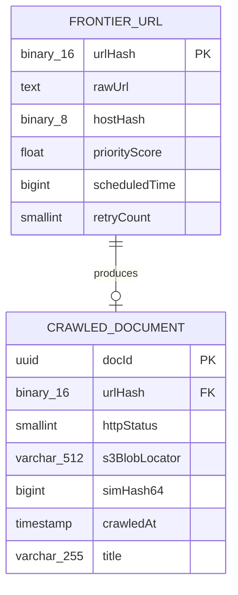
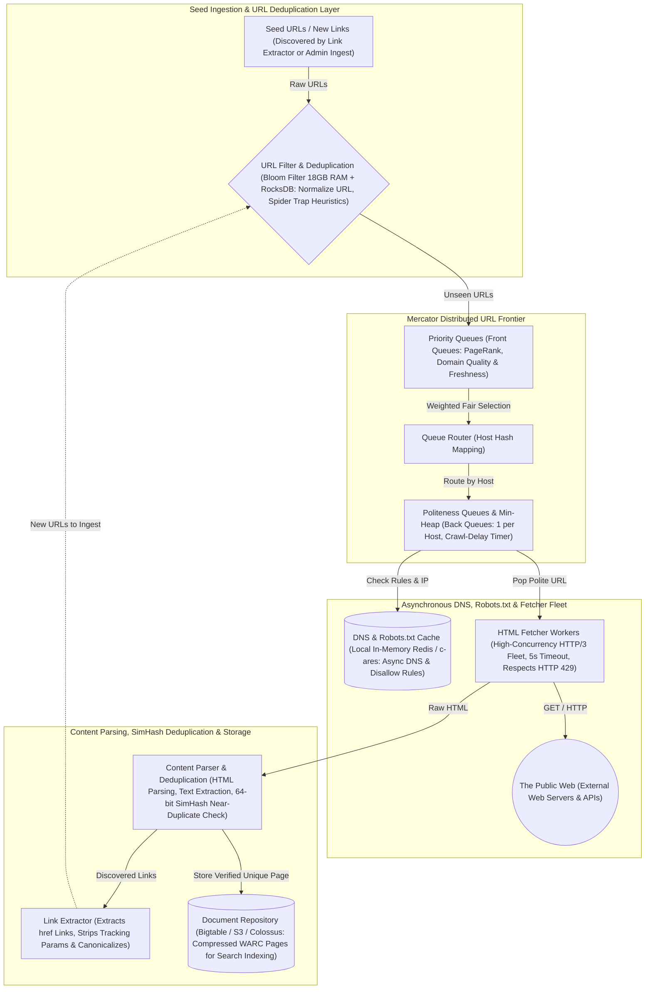

# Web Crawler System Design

[← Back to System Design](system-design.md)

## Overview

A web crawler (also known as a spider or bot) systematically traverses the World Wide Web to discover, fetch, parse, and index billions of web pages. Web crawlers form the data foundation for search engines (Google, Bing), web archiving (Wayback Machine), and large-scale AI dataset preparation (Common Crawl).

Designing a distributed web crawler requires solving foundational internet-scale systems challenges:

1. **Distributed URL Frontier**: Implementing the Mercator crawler model to balance high-priority pages (PageRank) against strict host politeness (never overwhelming a web server with requests).
2. **URL & Content Deduplication**: Preventing infinite loops and redundant fetching across trillions of links using scalable Bloom Filters and SimHash fingerprinting.
3. **High-Performance Asynchronous Fetching**: Avoiding DNS resolution bottlenecks and connection latency across diverse global web servers.
4. **Spider Traps & Malicious Content**: Detecting dynamically generated endless URL trees (calendars, session IDs) and filtering unsafe or low-value spam pages.

---

## Functional Requirements

* **Scalable Crawling**: Ingest seed URLs and systematically discover new hyperlinks recursively across the open internet.
* **Politeness Enforcement**: Strictly adhere to website `robots.txt` disallow rules and enforce crawl delays (e.g., minimum 1 second between requests to the same hostname).
* **Prioritization**: Prioritize crawling high-value, frequently updated domains (e.g., news portals, Wikipedia) over low-ranking spam pages.
* **Content Extraction & Storage**: Parse HTML, strip boilerplate/ads, extract clean text and metadata, and save compressed pages into a scalable document repository.
* **Deduplication**: Filter duplicate URLs and near-duplicate document contents (mirrors, syndication).

---

## Non-Functional Requirements

* **Planetary Scalability**: Capable of crawling over **$1\text{ Billion pages/month}$** ($\approx 400\text{ pages/second}$ sustained).
* **Robustness & Fault Tolerance**: Crash-resilient workers; bad HTML, malformed HTTP responses, or hanging server sockets must never crash worker threads.
* **Extensibility**: Support pluggable parsers for different MIME types (HTML, PDF, XML, JSON).
* **Data Freshness**: Re-visit dynamic pages (news sites) within hours while visiting static pages once every few months.

---

## Back of the Envelope Estimations

### Scale & Throughput

* **Monthly Crawl Volume**: $1\text{ Billion web pages/month}$.
* **Average Ingestion QPS**:
  $$\text{Crawl QPS} = \frac{1,000,000,000}{30 \times 86,400} \approx 386\text{ pages/second} \quad (\text{Peak: } \approx 1,500\text{ QPS})$$
* **Discovered URLs per Page**: Average $50\text{ outgoing links/page}$.
  $$\text{Link Discovery Rate} = 386 \times 50 \approx 19,300\text{ URLs/second to filter and deduplicate!}$$

### Storage Calculations

* **Average Page Size (Raw HTML)**: $100\text{ KB}$ (compressed to $25\text{ KB}$).
* **Monthly Raw HTML Storage**:
  $$1,000,000,000 \times 25\text{ KB} = 25\text{ Terabytes/month} \implies 300\text{ Terabytes/year}$$
* **URL Frontier Storage**:
  * 10 Billion discovered URLs in frontier queue $\times 100\text{ bytes} \approx 1\text{ Terabyte}$ RAM/SSD footprint.
* **Bloom Filter Size for 10 Billion URLs**:
  * With false positive rate $p = 0.001$ ($0.1\%$), bits per element $m/n \approx 14.4\text{ bits}$.
  * Total Bloom Filter Memory:
    $$10,000,000,000 \times 14.4\text{ bits} \approx 18\text{ Gigabytes RAM}$$
    *(Easily held in a single server's memory!)*.

---

## High-Level System Architecture



---

## Core Components & Mechanics

### 1. Mercator URL Frontier (Priority & Politeness)

A naive FIFO queue causes two catastrophic failures:

* **Denial of Service**: If a site has 100,000 pages, the crawler sends 100,000 rapid requests to a single web host, crashing their server.
* **Low Quality Crawl**: Scraping low-quality forum pages while ignoring critical front pages.



### 2. Near-Duplicate Detection (SimHash)

Websites often duplicate identical press releases, or differ only by timestamp/sidebar headers:

* **The SimHash Algorithm**:
  1. Extract key token words from the page and assign weights based on frequency.
  2. Map each token to a 64-bit hash.
  3. Combine the 64-bit vectors into a single 64-bit fingerprint for the document.
  4. Compare the **Hamming Distance** (count of bit differences) with existing page fingerprints.
  5. If $\text{Hamming Distance} \le 3$, the document is classified as a duplicate and dropped from storage.

---

## API Specifications (Crawler Admin & Control)

### 1. Ingest Seed URLs

```http
POST /api/v1/frontier/seeds
Authorization: Bearer <admin_token>
Content-Type: application/json
```

```json
// Request
{
  "seeds": [
    {"url": "https://en.wikipedia.org", "priority": 10},
    {"url": "https://news.ycombinator.com", "priority": 9}
  ],
  "crawlDepth": 5
}

// Response: 202 Accepted
{
  "acceptedUrls": 2,
  "status": "QUEUED_TO_FRONTIER"
}
```

### 2. Query Domain Crawl Status

```http
GET /api/v1/frontier/status?domain=en.wikipedia.org
Authorization: Bearer <admin_token>
```

```json
// Response: 200 OK
{
  "domain": "en.wikipedia.org",
  "politenessDelayMs": 1000,
  "robotsTxtStatus": "CACHED",
  "pagesCrawled": 412890,
  "pagesPendingInQueue": 18230,
  "lastCrawledAt": "2026-10-27T19:55:01Z"
}
```

---

## Object Model & Database Schema



---

## System Design Diagram



---

## Deep Dive & Key Technical Challenges

### 1. The DNS Resolution Bottleneck

* Fetching a page requires converting `example.com` to an IP address. Synchronous DNS calls (`gethostbyname`) block for 50–500ms, crippling fetcher throughput.
* **High-Throughput DNS Architecture**:
  * Dedicated DNS worker pool using non-blocking asynchronous resolvers (`c-ares` / `Unbound`).
  * In-memory local DNS cache with aggressive TTL overrides (caching DNS responses for 24 hours regardless of short DNS TTLs).
  * Worker threads reuse persistent HTTP/2 and HTTP/3 connection pools directly to the cached IP.

### 2. Preventing Spider Traps

* A spider trap is an infinite loop created by websites (e.g., dynamically generated calendars `/calendar/2026/11/01/2026/11/02/...` or infinite pagination).
* **Defensive Heuristics**:
  * **Max URL Depth**: Drop URLs with path segments exceeding 8 levels deep.
  * **Query Parameter Stripping**: Strip tracking params (`utm_source`, `ref`, `session_id`).
  * **Per-Host Crawl Quota**: Limit maximum pages fetched per domain per day unless explicitly whitelisted.

---

## Additional Notes

### Video References

* [](https://www.youtube.com/watch?v=6u25GckPhLU)
