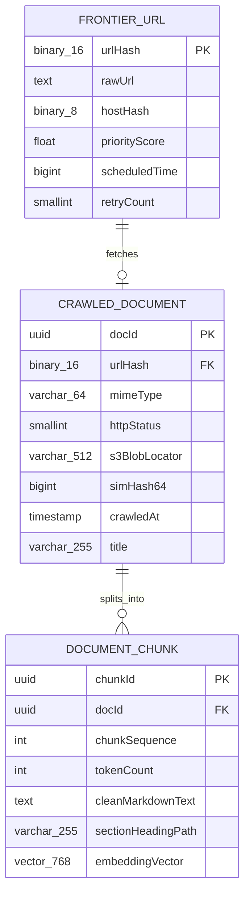

# Web Crawler & Large-Scale Document Ingestion Pipeline System Design

[← Back to System Design](system-design.md)

## Overview

A **Web Crawler & Large-Scale Document Ingestion Pipeline** systematically discovers, fetches, parses, deduplicates, chunks, and indexes billions of web pages and enterprise documents (HTML, PDFs, DOCX, Markdown, scanned images). This architecture forms the data foundation for web search engines (Google, Bing), web archives (Wayback Machine), enterprise knowledge platforms, and large-scale LLM / RAG dataset preparation pipelines (Common Crawl, FineWeb).

Designing a planetary-scale crawler and document ingestion pipeline requires solving five foundational distributed systems challenges:

1. **Distributed URL Frontier**: Implementing the Mercator crawler model to balance high-priority pages (PageRank / domain authority) against strict host politeness (never overwhelming an origin server).
2. **URL & Near-Duplicate Content Deduplication**: Preventing infinite crawl loops and redundant indexing across trillions of links and syndicated documents using sharded Bloom Filters, 64-bit SimHash, and MinHash LSH.
3. **High-Performance Asynchronous Fetching**: Eliminating DNS resolution bottlenecks, TLS handshake overhead, and socket hangs across diverse global servers.
4. **Multi-Format Document Parsing, OCR & Semantic Chunking**: Extracting clean text, tables, and layout metadata from heterogeneous formats (HTML DOM, PDF, DOCX, scanned images via OCR), stripping boilerplate/PII, and splitting documents into token-bounded semantic chunks for downstream search and RAG vector indexing.
5. **Spider Traps & Malicious Content Defense**: Detecting dynamically generated endless URL trees (calendars, session IDs), zip/decompression bombs, and low-quality spam pages.

---

## Functional Requirements

* **Scalable Web & Connector Ingestion**: Ingest seed URLs for recursive web crawling alongside direct enterprise document uploads/connectors (S3 buckets, SharePoint, Google Drive).
* **Politeness Enforcement**: Strictly adhere to website `robots.txt` disallow rules and enforce per-host crawl delays (e.g., minimum $1\text{ second}$ between requests to the same hostname).
* **Prioritization & Freshness**: Prioritize crawling high-value, frequently updated domains (e.g., news portals, documentation) over static or low-ranking pages.
* **Multi-Format Parsing & Extraction**: Parse HTML, PDF, DOCX, and scanned images (via OCR), strip boilerplate/navigation/ads, extract structured metadata and clean text, and chunk documents for search and embedding models.
* **Multi-Stage Deduplication**: Filter exact duplicate URLs, exact binary files (`SHA-256`), and near-duplicate document contents (`SimHash` / `MinHash LSH`).

---

## Non-Functional Requirements

* **Planetary Scalability**: Capable of crawling and ingesting over **$1\text{ Billion documents/month}$** ($\approx 400\text{ docs/second}$ sustained, $\approx 1,500\text{ docs/second}$ peak).
* **Robustness & Sandboxed Fault Tolerance**: Crash-resilient fetchers and sandboxed parser workers; malformed PDFs, zip bombs, bad HTML, or hanging sockets must never crash worker processes.
* **Extensibility**: Pluggable parser and enrichment stages supporting new MIME types (HTML, PDF, DOCX, XML, JSON, Audio/Video transcripts).
* **Data Freshness & Lineage**: Re-visit dynamic pages within hours while tracking document version lineage (`doc_id`, `chunk_id`, `source_etag`, `simhash64`) across re-crawls.

---

## Back of the Envelope Estimations

### Scale & Throughput

* **Monthly Document Volume**: $1\text{ Billion pages & documents/month}$.
* **Average Ingestion QPS**:
  $$\text{Ingestion QPS} = \frac{1,000,000,000}{30 \times 86,400} \approx 386\text{ docs/second} \quad (\text{Peak: } \approx 1,500\text{ QPS})$$
* **Discovered URLs per Page**: Average $50\text{ outgoing links/page}$.
  $$\text{Link Discovery Rate} = 386 \times 50 \approx 19,300\text{ URLs/second to filter and deduplicate!}$$
* **Document Chunking & Embedding Rate**: Average $8\text{ semantic chunks/document}$ ($512\text{ tokens/chunk}$).
  $$\text{Chunk Indexing Rate} = 386 \times 8 \approx 3,088\text{ chunks/second} \quad (\text{Peak: } \approx 12,000\text{ chunks/second})$$

### Storage Calculations

* **Average Raw Document Size**: $100\text{ KB}$ (compressed to $25\text{ KB}$ in WARC/Zstd format).
* **Monthly Raw Archive Storage**:
  $$1,000,000,000 \times 25\text{ KB} = 25\text{ Terabytes/month} \implies 300\text{ Terabytes/year}$$
* **Parsed Text & Vector Index Storage**:
  * Clean extracted text + metadata: $\sim 5\text{ KB/doc} \implies 5\text{ TB/month}$.
  * Vector embeddings (for top $10\%$ high-quality corpus = $100\text{M docs} \times 8\text{ chunks} = 800\text{M vectors/month}$ at $768\text{ dims} \times 2\text{ bytes (FP16)} \approx 1.2\text{ TB/month}$).
* **URL Frontier Storage**:
  * $10\text{ Billion}$ discovered URLs in frontier queue $\times 100\text{ bytes} \approx 1\text{ Terabyte}$ NVMe SSD footprint.
* **Bloom Filter Size for 10 Billion URLs**:
  * With false positive rate $p = 0.001$ ($0.1\%$), bits per element $m/n \approx 14.4\text{ bits}$.
  * Total Bloom Filter Memory:
    $$10,000,000,000 \times 14.4\text{ bits} \approx 18\text{ Gigabytes RAM}$$
    *(Easily held in a sharded in-memory service!)*.

---

## High-Level System Architecture

```mermaid
%%{init: {'flowchart': {'nodeSpacing': 25, 'rankSpacing': 45, 'padding': 10}}}%%
flowchart LR
    Seeds["Seed URLs &<br/>Doc Connectors"]
    subgraph FrontierTier["Dedupe & URL Frontier"]
        Dedupe["URL Dedupe<br/>(18GB Bloom Filter)"]
        Frontier[["Mercator URL Frontier"]]
    end
    subgraph FetchTier["Async Fetch Fleet"]
        Fetcher["HTTP/3 Fetcher &<br/>Async DNS"]
        RawBus[["Kafka Raw Doc Stream"]]
    end
    subgraph IngestionPipeline["Document Ingestion & Parsing Pipeline"]
        Parser["Multi-Format Parser<br/>(DOM / PDF / OCR)"]
        ContentDedupe["Near-Dedupe<br/>(64b SimHash / MinHash)"]
        Chunker["Semantic Chunker &<br/>Embedding Worker"]
        LinkExt["Link Extractor &<br/>Canonicalizer"]
    end
    subgraph DataLayer["Storage & Search Indexes"]
        DocRepo[("Document Archive<br/>(S3 WARC / Parquet)")]
        SearchIdx[("Elasticsearch &<br/>Vector DB Index")]
    end

    Seeds e1@-->|"Ingest Links"| Dedupe
    Dedupe e2@-->|"Unseen URLs"| Frontier
    Frontier e3@-->|"Polite URL"| Fetcher
    Fetcher e4@-->|"Raw Payload"| RawBus
    RawBus e5@-->|"HTML / PDF / DOCX"| Parser
    Parser e6@-->|"Outgoing hrefs"| LinkExt
    LinkExt e7@-.->|"Loop URLs"| Dedupe
    Parser e8@-->|"Clean Text + Layout"| ContentDedupe
    ContentDedupe e9@-->|"Unique WARC"| DocRepo
    ContentDedupe e10@-->|"Unique Doc"| Chunker
    Chunker e11@-->|"Chunks + Embeddings"| SearchIdx

    e1@{ animate: true }
    e2@{ animate: true }
    e3@{ animate: true }
    e4@{ animate: true }
    e5@{ animate: true }
    e6@{ animate: true }
    e7@{ animate: true }
    e8@{ animate: true }
    e9@{ animate: true }
    e10@{ animate: true }
    e11@{ animate: true }

    classDef client fill:#1d4ed8,stroke:#60a5fa,stroke-width:2px,color:#ffffff
    classDef edge fill:#6d28d9,stroke:#a78bfa,stroke-width:2px,color:#ffffff
    classDef service fill:#047857,stroke:#34d399,stroke-width:2px,color:#ffffff
    classDef worker fill:#0e7490,stroke:#22d3ee,stroke-width:2px,color:#ffffff
    classDef storage fill:#b45309,stroke:#fbbf24,stroke-width:2px,color:#ffffff
    classDef queue fill:#3730a3,stroke:#818cf8,stroke-width:2px,color:#ffffff

    class Seeds client
    class Dedupe edge
    class Frontier,RawBus queue
    class Fetcher service
    class Parser,ContentDedupe,Chunker,LinkExt worker
    class DocRepo,SearchIdx storage

    style FrontierTier fill:transparent,stroke:#818cf8,stroke-width:1.5px,stroke-dasharray: 5 5
    style FetchTier fill:transparent,stroke:#34d399,stroke-width:1.5px,stroke-dasharray: 5 5
    style IngestionPipeline fill:transparent,stroke:#22d3ee,stroke-width:1.5px,stroke-dasharray: 5 5
    style DataLayer fill:transparent,stroke:#fbbf24,stroke-width:1.5px,stroke-dasharray: 5 5
```



---

## Core Components & Mechanics

### 1. Mercator URL Frontier (Priority & Politeness)

A naive FIFO queue causes two catastrophic failures:

* **Denial of Service**: If a site has 100,000 pages, the crawler sends 100,000 rapid requests to a single web host, crashing their server.
* **Low Quality Crawl**: Scraping low-quality forum pages while ignoring critical front pages.

```mermaid
%%{init: {'flowchart': {'nodeSpacing': 20, 'rankSpacing': 40, 'padding': 10}}}%%
flowchart LR
    Incoming["Incoming Discovered URLs"]
    subgraph FrontTier["Front Queues (Priority)"]
        PriorityQueues[["Priority Queues (PageRank)"]]
        QueueRouter{"Host Queue Router"}
    end
    subgraph BackTier["Back Queues (Politeness)"]
        PolitenessQueues[["Back Queues (1 per Host)"]]
        MinHeap["Crawl-Delay Min-Heap"]
    end
    FetcherWorker["Fetcher Worker"]

    Incoming e1@-->|"Rank"| PriorityQueues
    PriorityQueues e2@-->|"Weighted Select"| QueueRouter
    QueueRouter e3@-->|"Hash Host"| PolitenessQueues
    PolitenessQueues e4@-->|"Schedule"| MinHeap
    MinHeap e5@-->|"Pop Elapsed"| FetcherWorker

    e1@{ animate: true }
    e2@{ animate: true }
    e3@{ animate: true }
    e4@{ animate: true }
    e5@{ animate: true }

    classDef client fill:#1d4ed8,stroke:#60a5fa,stroke-width:2px,color:#ffffff
    classDef edge fill:#6d28d9,stroke:#a78bfa,stroke-width:2px,color:#ffffff
    classDef service fill:#047857,stroke:#34d399,stroke-width:2px,color:#ffffff
    classDef worker fill:#0e7490,stroke:#22d3ee,stroke-width:2px,color:#ffffff
    classDef queue fill:#3730a3,stroke:#818cf8,stroke-width:2px,color:#ffffff

    class Incoming client
    class PriorityQueues,PolitenessQueues queue
    class QueueRouter edge
    class MinHeap service
    class FetcherWorker worker

    style FrontTier fill:transparent,stroke:#a78bfa,stroke-width:1.5px,stroke-dasharray: 5 5
    style BackTier fill:transparent,stroke:#34d399,stroke-width:1.5px,stroke-dasharray: 5 5
```



### 2. Multi-Format Document Ingestion, Parsing & Chunking Pipeline

Once raw bytes are fetched (or uploaded via enterprise connectors), the **Document Ingestion Pipeline** transforms unstructured binary blobs into clean, searchable semantic units:

```text
┌─────────────────────────────────────────────────────────────────────────┐
│                Large-Scale Document Ingestion Pipeline                  │
│                                                                         │
│  [Raw Bytes (HTML / PDF / DOCX / Scanned Image)]                        │
│        │                                                                │
│        ▼                                                                │
│  1. MIME Detection & Sandboxed Triage (Magic Bytes, ClamAV, Zip-Bomb)   │
│        │                                                                │
│        ├──► HTML/DOM ──► Readability / Trafilatura (Boilerplate Strip)  │
│        ├──► Digital PDF/DOCX ──► PDFium / Apache Tika (Text + Tables)   │
│        └──► Scanned PDF/Image ──► GPU OCR Worker Pool (Tesseract/ViT)   │
│        │                                                                │
│        ▼                                                                │
│  2. Normalization, Language ID (fastText), PII Redaction & SimHash      │
│        │                                                                │
│        ▼                                                                │
│  3. Structure-Aware Semantic Chunker (256-512 tokens, 10% overlap)      │
│        │                                                                │
│        ▼                                                                │
│  4. Dual Indexing: BM25 Inverted Index (ES) + Dense Embeddings (HNSW)   │
└─────────────────────────────────────────────────────────────────────────┘
```

* **MIME Detection & Format-Specific Extraction**:
  * Inspects file magic bytes (`%PDF-`, `PK\x03\x04` for DOCX, `<!DOCTYPE html>`) rather than trusting HTTP `Content-Type` headers.
  * **HTML**: Strips navigation bars, footers, scripts, and ads using DOM text-density heuristics (`Trafilatura` / `Readability`), converting the main article into structured Markdown.
  * **PDF & Office Documents**: Extracts embedded text streams and reconstructs bounding-box tables. Pages with low character density ($< 20\text{ chars/page}$) are routed to a dedicated asynchronous **GPU OCR Queue** so slow OCR jobs never block fast HTML/text workers.
* **Structure-Aware Semantic Chunking**:
  * Instead of splitting naively at fixed character offsets (which slices sentences and tables in half), the chunker respects Markdown headings (`#`, `##`), paragraph boundaries, and table blocks, packing sections into $256\text{–}512\text{ token}$ windows with $10\%$ sliding overlap and attaching parent document metadata (`doc_id`, `url`, `section_path`) to every chunk.

### 3. Near-Duplicate Detection (SimHash & MinHash LSH)

Websites and enterprise repositories frequently duplicate identical press releases, boilerplate templates, or syndicated articles that differ only by timestamps or headers:

* **The 64-Bit SimHash Algorithm**:
  1. Extract character/word $n$-grams (shingles) from the normalized document text and assign TF-IDF weights.
  2. Map each token to a 64-bit hash; maintain a 64-dimensional accumulator vector where bit $i = 1$ adds $+w$ and bit $i = 0$ adds $-w$.
  3. Collapse the accumulator signs into a single **64-bit SimHash fingerprint** for the document.
  4. Compare the **Hamming Distance** (count of differing bits) against existing fingerprints partitioned into 4 blocks of 16 bits (Pigeonhole Principle).
  5. If $\text{Hamming Distance} \le 3$, the document is classified as a near-duplicate, linked to the canonical `doc_id`, and skipped from expensive embedding/indexing.

---

## API Specifications (Crawler & Ingestion Control)

### 1. Ingest Seed URLs or Document Batch

```http
POST /api/v1/ingestion/jobs
Authorization: Bearer <admin_token>
Content-Type: application/json
```

```json
{
  "sourceType": "WEB_CRAWL",
  "seeds": [
    {"url": "https://en.wikipedia.org", "priority": 10},
    {"url": "https://arxiv.org/list/cs/recent", "priority": 9}
  ],
  "crawlDepth": 5,
  "parsingConfig": {
    "allowedMimeTypes": ["text/html", "application/pdf"],
    "enableOcr": true,
    "chunkSizeTokens": 512,
    "chunkOverlapTokens": 50
  }
}
```

```json
{
  "jobId": "job_99210a8b",
  "acceptedSeeds": 2,
  "status": "QUEUED_TO_FRONTIER"
}
```

### 2. Query Domain Crawl & Ingestion Status

```http
GET /api/v1/frontier/status?domain=en.wikipedia.org
Authorization: Bearer <admin_token>
```

```json
{
  "domain": "en.wikipedia.org",
  "politenessDelayMs": 1000,
  "robotsTxtStatus": "CACHED",
  "pagesCrawled": 412890,
  "documentsIndexed": 389120,
  "nearDuplicatesDropped": 23770,
  "pagesPendingInQueue": 18230,
  "lastCrawledAt": "2026-10-27T19:55:01Z"
}
```

---

## Object Model & Database Schema

### Database Selection & Rationale

| Workload / Subsystem | Database Choice | Data Model & CAP Profile | Why This Database? (Justification & Trade-offs) |
| :--- | :--- | :--- | :--- |
| **Seen URL Deduplication (`10B+ URLs`)** | **In-Memory Sharded Bloom Filter (backed by RocksDB)** | Probabilistic Bit Array + Embedded LSM KV (**AP / Sub-ms**) | **Why:** At $19,300\text{ discovered URLs/sec}$, querying a disk-based SQL/NoSQL database to check if a URL was already crawled creates an insurmountable disk IOPS bottleneck. A sharded Bloom Filter holds $10\text{ Billion}$ URLs in just $\sim 18\text{ GB}$ of RAM ($0.1\%$ false-positive rate), filtering $99.9\%$ of duplicate links in $< 0.1\text{ ms}$ without disk I/O. |
| **Mercator URL Frontier (`FRONTIER_URL`)** | **RocksDB (Local NVMe SSD) + Redis Min-Heap** | Embedded LSM-Tree Queue + In-Memory Heap (**High-Throughput FIFO**) | **Why:** The frontier buffers $10\text{ Billion}$ pending URLs ($\sim 1\text{ TB}$), which exceeds comfortable pure-RAM capacity but requires tens of thousands of enqueue/dequeue ops/sec. Embedded RocksDB on local NVMe SSDs provides sequential append/scan speeds without network serialization overhead, while an in-memory Min-Heap tracks per-host `nextAllowedCrawlTime` politeness deadlines. |
| **Crawl Metadata & SimHash Fingerprints (`CRAWLED_DOCUMENT`)** | **Apache Cassandra / Google Cloud Bigtable** | Wide-Column Store (**AP / PA-EL**) | **Why:** Stores billions of crawled document metadata rows (`urlHash`, `mimeType`, `simHash64`, `crawledAt`, `s3BlobLocator`), partitioned by reversed domain (`org.wikipedia.en`) so all documents belonging to the same host are co-located on disk for locality-aware batch indexing and re-crawl scheduling. |
| **Parsed Chunks, Full-Text & Vector Index (`DOCUMENT_CHUNK`)** | **Elasticsearch / OpenSearch + Milvus / Qdrant** | Inverted Index (BM25) + HNSW Vector Index (**AP / Near-Real-Time**) | **Why:** Enables hybrid lexical (BM25 keyword) and semantic (dense vector cosine similarity) retrieval over billions of parsed $512\text{-token}$ document chunks with metadata filtering (`domain`, `language`, `published_at`). |
| **DNS & `robots.txt` Politeness Cache** | **Redis Cluster (+ Local Worker LRU Cache)** | In-Memory Key-Value (**AP / 24h TTL**) | **Why:** Every fetch requires checking host `robots.txt` rules and resolving DNS. Caching parsed `Disallow` directives and resolved IP addresses in Redis/local RAM eliminates millions of redundant external HTTP/DNS lookups. |
| **Compressed Raw HTML / PDF Archive** | **AWS S3 / Google Colossus (WARC & Parquet)** | Object Storage (**11 9s Durability**) | **Why:** Stores $25\text{ TB/month}$ ($300\text{ TB/year}$) of compressed raw WARC bundles and cleaned Parquet datasets cheaply so parser or embedding upgrades can re-process historical corpora without re-crawling the web. |



---

## System Design Diagram

```mermaid
%%{init: {'flowchart': {'nodeSpacing': 20, 'rankSpacing': 40, 'padding': 10}}}%%
flowchart LR
    subgraph SeedAndDedupe["Seed & URL Deduplication"]
        SeedUrls["Seed URLs & Doc Connectors"]
        UrlFilter{"URL Filter (18GB Bloom Filter)"}
    end
    subgraph MercatorFrontier["Mercator URL Frontier"]
        PriorityQueues[["Priority Front Queues (PageRank)"]]
        QueueRouter["Host Queue Router"]
        PolitenessQueues[["Politeness Back Queues (Min-Heap)"]]
    end
    subgraph CoreServices["Fetcher & Multi-Format Ingestion Fleet"]
        Fetcher["Async Fetcher Fleet (HTTP/3)"]
        KafkaRaw[["Kafka Raw Payload Bus"]]
        Parser["Sandboxed Parser (DOM / PDF / OCR)"]
        LinkExtractor["Link Extractor & Canonicalizer"]
        Chunker["Semantic Chunker & Embedder"]
    end
    subgraph DataAndEventTier["Caches, Archive & Search Indexes"]
        DnsRobots[("DNS & Robots.txt Cache (Redis)")]
        Internet(("The Public Web (Origin Servers)"))
        DocRepo[("Raw Archive (S3 WARC / Parquet)")]
        SearchDB[("Hybrid Index (Elasticsearch + Vector DB)")]
    end
    SeedUrls e1@-->|"Raw URLs"| UrlFilter
    UrlFilter e2@-->|"Unseen URLs"| PriorityQueues
    PriorityQueues e3@-->|"Fair Select"| QueueRouter
    QueueRouter e4@-->|"By Host"| PolitenessQueues
    PolitenessQueues e5@-->|"Pop Polite"| Fetcher
    Fetcher e6@-->|"Check IP/Rules"| DnsRobots
    Fetcher e7@-->|"GET / HTTP"| Internet
    Fetcher e8@-->|"Raw Bytes"| KafkaRaw
    KafkaRaw e9@-->|"Consume"| Parser
    Parser e10@-->|"Extract href"| LinkExtractor
    LinkExtractor e11@-.->|"Loop URLs"| UrlFilter
    Parser e12@-->|"SimHash Unique WARC"| DocRepo
    Parser e13@-->|"Clean Markdown"| Chunker
    Chunker e14@-->|"Chunks + Embeddings"| SearchDB

    e1@{ animate: true }
    e2@{ animate: true }
    e3@{ animate: true }
    e4@{ animate: true }
    e5@{ animate: true }
    e6@{ animate: true }
    e7@{ animate: true }
    e8@{ animate: true }
    e9@{ animate: true }
    e10@{ animate: true }
    e11@{ animate: true }
    e12@{ animate: true }
    e13@{ animate: true }
    e14@{ animate: true }

    classDef client fill:#1d4ed8,stroke:#60a5fa,stroke-width:2px,color:#ffffff
    classDef edge fill:#6d28d9,stroke:#a78bfa,stroke-width:2px,color:#ffffff
    classDef service fill:#047857,stroke:#34d399,stroke-width:2px,color:#ffffff
    classDef worker fill:#0e7490,stroke:#22d3ee,stroke-width:2px,color:#ffffff
    classDef cache fill:#be123c,stroke:#fb7185,stroke-width:2px,color:#ffffff
    classDef storage fill:#b45309,stroke:#fbbf24,stroke-width:2px,color:#ffffff
    classDef queue fill:#3730a3,stroke:#818cf8,stroke-width:2px,color:#ffffff

    class SeedUrls,Internet client
    class UrlFilter,QueueRouter edge
    class PriorityQueues,PolitenessQueues,KafkaRaw queue
    class Fetcher service
    class Parser,LinkExtractor,Chunker worker
    class DnsRobots cache
    class DocRepo,SearchDB storage

    style SeedAndDedupe fill:transparent,stroke:#60a5fa,stroke-width:1.5px,stroke-dasharray: 5 5
    style MercatorFrontier fill:transparent,stroke:#818cf8,stroke-width:1.5px,stroke-dasharray: 5 5
    style CoreServices fill:transparent,stroke:#34d399,stroke-width:1.5px,stroke-dasharray: 5 5
    style DataAndEventTier fill:transparent,stroke:#fbbf24,stroke-width:1.5px,stroke-dasharray: 5 5
```



---

## Deep Dive & Key Technical Challenges

### 1. The DNS Resolution Bottleneck

* Fetching a page requires converting `example.com` to an IP address. Synchronous DNS calls (`gethostbyname`) block for 50–500ms, crippling fetcher throughput.
* **High-Throughput DNS Architecture**:
  * Dedicated DNS worker pool using non-blocking asynchronous resolvers (`c-ares` / `Unbound`).
  * In-memory local DNS cache with aggressive TTL overrides (caching DNS responses for 24 hours regardless of short DNS TTLs).
  * Worker threads reuse persistent HTTP/2 and HTTP/3 connection pools directly to the cached IP.

### 2. Preventing Spider Traps & Parser Bombs

* **Spider Traps**: Infinite URL loops created by websites (e.g., dynamically generated calendars `/calendar/2026/11/01/2026/11/02/...` or infinite pagination).
  * **Max URL Depth & Canonicalization**: Drop URLs with path segments exceeding 8 levels deep and strip tracking/session parameters (`utm_source`, `ref`, `phpsessid`).
  * **Per-Host Crawl Quota**: Enforce daily crawl budgets per domain unless explicitly whitelisted.
* **Parser & Decompression Bombs**: Malicious or corrupted PDFs, deeply nested XML/HTML DOM trees, or gzip bombs ($10\text{ MB}$ compressed payload expanding to $100\text{ GB}$ in RAM) can crash ingestion workers.
  * **Streaming Byte Caps & Sandboxed Subprocesses**: Enforce a hard streaming decompression limit (e.g., max $50\text{ MB}$ uncompressed stream) and execute native PDF/Office parsers inside ephemeral `seccomp`/`cgroup`-constrained worker containers with a strict $10\text{-second}$ CPU timeout.

### 3. Handling Fast vs. Slow Ingestion Lanes (HTML vs. OCR / Headless Browser)

* Standard static HTML parsing takes $< 5\text{ ms}$ on CPU, whereas rendering a JavaScript SPA in Headless Chromium or running Vision-Language OCR on a 50-page scanned PDF takes $2\text{–}15\text{ seconds}$ on GPU.
* **Multi-Lane Topic Isolation**:
  * If all documents share a single FIFO worker pool, a batch of 10,000 scanned PDFs will cause head-of-line blocking and stall web crawling throughput.
  * The ingestion pipeline routes payloads into three isolated Kafka topic lanes with independent autoscaling worker pools:
    1. **`ingest.fast.html`** (CPU-bound DOM extraction, target latency $< 50\text{ ms}$).
    2. **`ingest.medium.office`** (CPU-bound digital PDF/DOCX parsing, target latency $< 500\text{ ms}$).
    3. **`ingest.slow.ocr_render`** (GPU-accelerated OCR and Headless Browser SPA rendering, target latency $< 30\text{ s}$).

---

## Additional Notes

### Video References

* [](https://www.youtube.com/watch?v=6u25GckPhLU)
