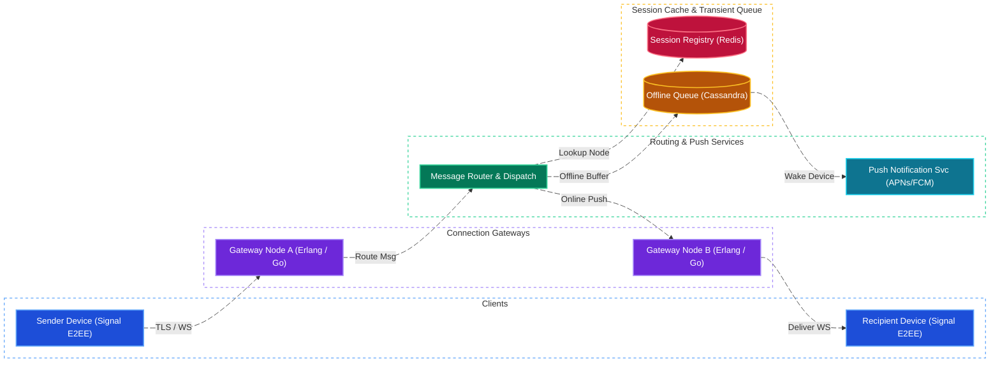
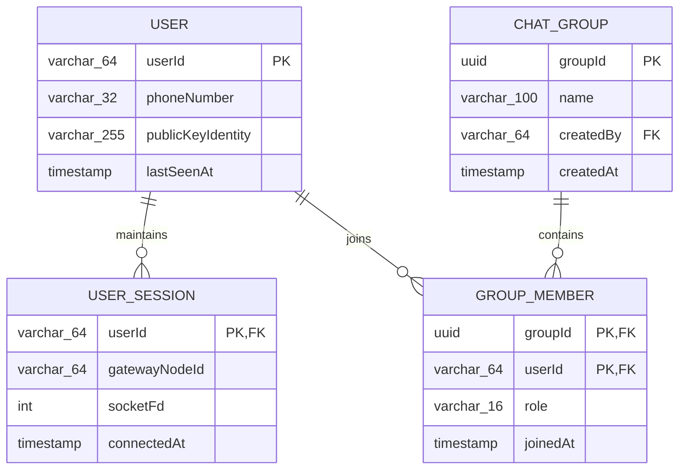
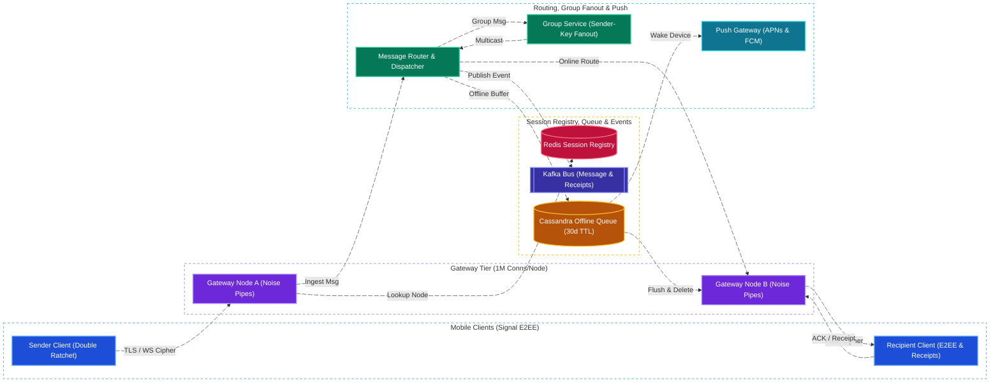

# WhatsApp / Chat System Design

[← Back to System Design](system-design.md)

> **Core Building Blocks Used**: [Chapter 1 — Stateful WebSockets & Redis Pub/Sub Connection Routing](fundamentals/01-networking-and-api-paradigms.md#websockets-deep-dive--horizontal-scaling-architecture) · [Chapter 4 — Wide-Column Inbox Store (Cassandra) & Pre-Signed Media Blobs](fundamentals/04-databases-sql-vs-nosql.md#5-wide-column--column-family-stores-cassandra-scylladb-bigtable) · [Chapter 5 — Snowflake Time-Ordered Message IDs & Per-Chat Sequence Ordering](fundamentals/05-distributed-systems-and-messaging.md#6-distributed-unique-id-generation-snowflake-uuidv7-ticket-servers) · [Chapter 8 — End-to-End Encryption (Signal Double Ratchet / X3DH)](fundamentals/08-security-multi-region-and-deployments.md#2-data-security-encryption--perimeter-defense)

## Overview

WhatsApp is a global, real-time instant messaging platform supporting over 2 billion active users transmitting more than 100 billion messages daily. The platform enables 1-on-1 private chats, group conversations, media attachments (images, voice notes, video clips), message delivery receipts, voice/video calls, and end-to-end encryption (E2EE).

The core technical challenge is maintaining hundreds of millions of persistent, bidirectional connections (WebSockets / TLS over TCP) with ultra-low latency, guaranteeing message delivery without loss across erratic mobile connections, and routing messages without ever storing decrypted plaintext on servers.

---

## Functional Requirements

* **1-on-1 Real-Time Messaging**: Send and receive text and voice messages with immediate delivery.
* **Message Delivery Receipts**: Visual state transitions: Sent (single check ✓), Delivered to device (double check ✓✓), and Read by recipient (blue double check ✓✓).
* **Group Chats**: Chat rooms supporting up to 1,024 participants with real-time message distribution.
* **Offline Message Queuing**: If a recipient is offline, buffer messages safely until the device reconnects.
* **Media Sharing**: Send compressed photos, videos, audio notes, and documents with end-to-end encryption.
* **Presence & Last Seen**: Real-time display of user online status and last-seen timestamps.
* **End-to-End Encryption (E2EE)**: Messages and media encrypted on the sending device and decryptable only on the recipient device.

---

## Non-Functional Requirements

* **Sub-100ms Message Latency**: End-to-end message transit between two online users must complete in **$< 100\text{ ms}$** globally.
* **Zero Message Loss (100% Reliability)**: Once acknowledged by the server, a message must never be lost.
* **Transient Server Storage**: Servers operate as a store-and-forward pipe; delivered messages are deleted from server storage immediately upon delivery receipt.
* **High Availability (99.999%)**: Connection gateways must support seamless connection handoff across cellular towers and Wi-Fi networks.
* **E2E Cryptographic Security**: Zero-knowledge architecture utilizing the **Signal Protocol** (Double Ratchet + X3DH key agreement).

---

## Back of the Envelope Estimations

### Scale & Throughput

* **Active Users**: $2\text{ Billion users}$.
* **Daily Messages Sent**: $100\text{ Billion messages/day}$.
* **Average Message Ingestion QPS**:
  $$\text{Average QPS} = \frac{100,000,000,000}{86,400} \approx 1,157,000\text{ messages/sec (1.15M QPS)}$$
* **Peak QPS** ($2.5\times$ peak factor on holidays / midnight):
  $$\text{Peak QPS} \approx 2,900,000\text{ messages/sec (2.9M QPS)}$$
* **Concurrent Connected Users**:
  * Assume $25\%$ of users maintain active TCP/WebSocket connections at peak $= 500\text{ Million concurrent connections}$.

### Connection Gateway Sizing

* A well-tuned Erlang / Elixir / Go gateway machine can comfortably maintain **1 million concurrent idle TCP connections** using efficient epoll/kqueue event loops.
* **Gateway Fleet Required**:
  $$\frac{500,000,000\text{ connections}}{1,000,000\text{ conns/server}} \approx 500\text{ Gateway Servers}$$

### Transient Storage

* Average text message payload: $\approx 100\text{ bytes}$ (encrypted ciphertext + metadata).
* If $10\%$ of recipients are temporarily offline at any given moment ($10\text{ Billion pending messages}$):
  $$10,000,000,000 \times 100\text{ bytes} \approx 1\text{ Terabyte of transient storage}$$
  *(Held in a distributed key-value store such as Cassandra or Redis cluster with automatic TTL).*

---

## High-Level System Architecture



---

## Core Components & Deep Dives

### 1. End-to-End Encryption (The Signal Protocol)

WhatsApp never sees unencrypted message text or attachments.

* **X3DH (Extended Triple Diffie-Hellman)**:
  * When a user registers, they upload one-time cryptographic pre-keys to the key server.
  * When Alice initiates a chat with Bob, her app fetches Bob's public pre-keys from the server and establishes a shared secret key entirely on-device, even if Bob is offline.
* **Double Ratchet Algorithm**:
  * For every single message sent, the encryption keys "ratchet" forward using a combination of symmetric KDF and Diffie-Hellman exchanges.
  * **Forward Secrecy**: If an attacker compromises Alice's phone today, they cannot decrypt any previously sent messages.
  * **Break-in Recovery**: Once the ratchet advances, future messages cannot be decrypted even if an ephemeral key was leaked.

### 2. Message Lifecycle & State Machine

1. **Sending (Clock icon)**: Message composed and encrypted locally on sender's device.
2. **Sent (Single Grey Checkmark ✓)**:
   * Client transmits ciphertext over WebSocket to Gateway Node A.
   * Gateway A writes message to Kafka / Routing Engine and returns an immediate TCP ACK to the sender. Sender displays single checkmark.
3. **Delivered (Double Grey Checkmark ✓✓)**:
   * Router checks User Session Registry: Recipient is connected to Gateway Node B.
   * Node B pushes ciphertext to Recipient.
   * Recipient phone decrypts message and immediately returns a `DELIVERY_RECEIPT` packet back to the server.
   * Server forwards receipt back to Sender; Sender displays double checkmark.
4. **Read (Double Blue Checkmark ✓✓)**:
   * Recipient opens the chat window. A `READ_RECEIPT` event is sent back to the sender.

### 3. Group Messaging Architecture

* **Server-Side Fan-Out vs. Client-Side Fan-Out**:
  * In WhatsApp's E2E encrypted model, client-side fan-out would require the sender to encrypt and upload $1,000$ copies of a video for a 1,000-person group (destroying mobile uplink bandwidth).
  * **Sender-Key Protocol (WhatsApp's solution)**:
    1. Sender generates an ephemeral random symmetric **Sender Key** locally.
    2. Sender encrypts this Sender Key individually for each group member once.
    3. The actual message (or media) is encrypted **only once** using the Sender Key.
    4. The encrypted payload is uploaded to the server once; the server performs efficient multicast fan-out to the group's participants without being able to decrypt the payload.

---

## API & Protocol Specifications

WhatsApp uses a customized binary protocol built on top of **XMPP (Extensible Messaging and Presence Protocol)** over TLS, called **Noise Pipes**:

### Send Message Frame (Protobuf Equivalent)

```protobuf
message ChatMessage {
  string message_id = 1;         // Client-generated UUID
  string sender_id = 2;
  string recipient_id = 3;       // User ID or Group ID
  int64 timestamp = 4;
  bytes encrypted_payload = 5;   // Ciphertext
  MessageType type = 6;          // TEXT, IMAGE, AUDIO, VIDEO
  string sender_key_id = 7;
}

message MessageReceipt {
  string message_id = 1;
  string recipient_id = 2;
  ReceiptType status = 3;        // DELIVERED, READ
  int64 timestamp = 4;
}
```

---

## Object Model & Database Schema

### Database Selection & Rationale

| Workload / Subsystem | Database Choice | Data Model & CAP Profile | Why This Database? (Justification & Trade-offs) |
| :--- | :--- | :--- | :--- |
| **Live User Session Registry & Presence (`USER_SESSION`)** | **Redis Cluster / Erlang Mnesia (In-Memory Distributed Table)** | In-Memory Key-Value (**AP / Sub-ms**) | **Why:** Routing $1.15\text{M}\text{--}2.9\text{M messages/sec}$ requires knowing which of the 500 Gateway Servers holds `recipient_id`'s open TCP/WebSocket connection in $< 1\text{ ms}$. Mnesia/Redis stores ephemeral `(userId -> gatewayNodeId, lastSeenAt)` mappings entirely in RAM with heartbeat TTLs. |
| **Transient Offline Message Inbox (`OfflineQueue`)** | **Apache Cassandra / Amazon DynamoDB** | Wide-Column Key-Value (**AP / PA-EL**) | **Why:** WhatsApp is a store-and-forward system: messages for offline recipients ($\sim 1\text{ TB}$ transient buffer) must be written at hundreds of thousands of ops/sec, fetched in strict chronological order when the device reconnects (`PRIMARY KEY (recipient_id, message_id)`), and deleted (or auto-expired via 30-day TTL) once the `DELIVERY_RECEIPT` ACK arrives. |
| **Users, Signal Pre-Keys & Group Memberships (`USER`, `CHAT_GROUP`, `GROUP_MEMBER`)** | **Sharded MySQL / CockroachDB (+ Redis Cache)** | Relational (ACID, **CP / PC-EC**) | **Why:** User identity registration, X3DH cryptographic public pre-key bundles (`publicKeyIdentity`), and group participant lists (`GROUP_MEMBER`, max 1,024 members) require strong consistency (`CP`) so group membership additions/removals and E2EE key rotations are immediately authoritative. |
| **Local Chat History (Permanent Storage)** | **SQLite (with SQLCipher AES-256 on Client Device)** | Embedded On-Device Relational (**Local ACID**) | **Why:** Because of End-to-End Encryption (E2EE) and privacy architecture, WhatsApp servers never retain delivered message history. Full searchable chat history lives locally in an encrypted SQLite database on the user's phone (with optional E2EE cloud blob backup to iCloud / Google Drive). |
| **Encrypted Media Attachments** | **AWS S3 / CDN Blob Store (Ephemeral 30-Day TTL)** | Object Storage (**11 9s Durability**) | **Why:** Encrypted image/video/voice blobs are uploaded directly to blob storage; the sender transmits only the download URL and AES-256 decryption key inside the E2EE Signal message, and the blob is purged once downloaded. |



---

## System Design Diagram



---

## Additional Notes

### Video References

* [](https://www.youtube.com/watch?v=cr6p0n0N-VA)
* [](https://www.youtube.com/watch?v=ZYlaiAPfbhw)
* [](https://www.youtube.com/watch?v=xyLO8ZAk2KE)
