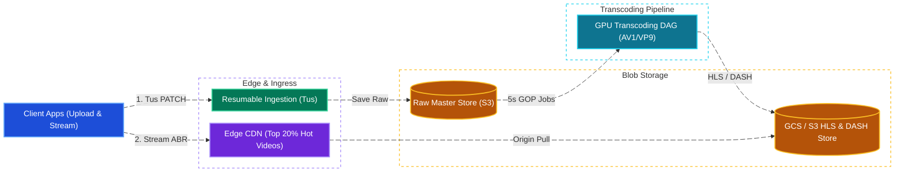
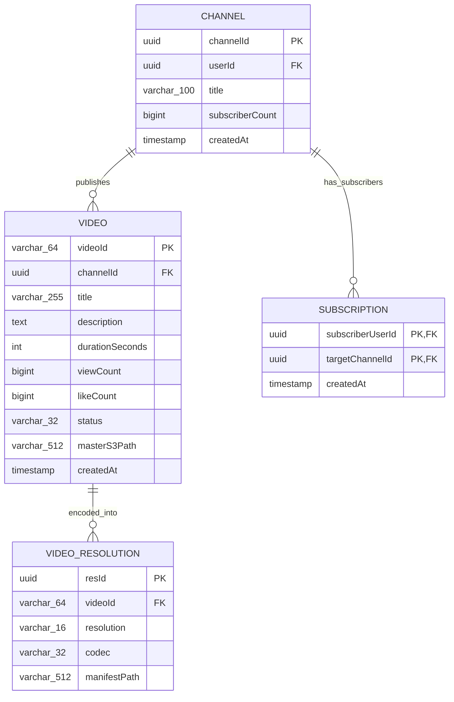
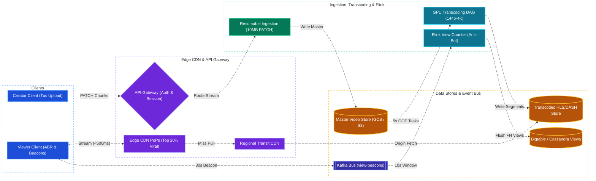

# YouTube System Design

[← Back to System Design](system-design.md)

## Overview

YouTube is the world's largest user-generated video sharing platform, supporting over 2.5 billion monthly active users. Users can upload, stream, search, like, comment, and subscribe to video channels.

Unlike curated VOD services like Netflix, YouTube must handle massive, uncontrolled write traffic: over **500 hours of new video content are uploaded every single minute**. The architecture requires a resilient resumable video upload pipeline, distributed DAG-based transcoding worker farms, efficient global CDN distribution balancing hot videos vs. massive long-tail storage, and a real-time view counting pipeline with anti-fraud auditing.

---

## Functional Requirements

* **Resumable Video Upload**: Creators can upload large video files (up to dozens of gigabytes) with chunking and automatic resumption upon network failure.
* **Video Transcoding & Processing**: Automatically convert uploaded videos into multiple resolutions (144p, 360p, 720p, 1080p, 4K) and codecs (H.264, VP9, AV1) for Adaptive Bitrate Streaming (ABR).
* **Video Streaming**: Low-latency video playback using HLS and MPEG-DASH.
* **Search & Recommendations**: Full-text video search by title/tags, and personalized homepage recommendations.
* **Engagement & Social Interactions**: Channel subscriptions, likes, comments, and real-time view counts.

---

## Non-Functional Requirements

* **Ultra-Low Playback Latency**: Video playback must begin within **$< 500\text{ ms}$** without rebuffering.
* **Upload Reliability & Fault Tolerance**: Interrupted 10 GB uploads must resume from the last successful chunk without re-uploading the entire file.
* **Massive Storage Scalability**: Ingest over **$80\text{ Petabytes}$ of new video per day**.
* **High Availability (99.99%)**: Streaming and video playback must remain available 24/7 globally.
* **View Count Integrity**: Accurate view tracking with fraud/bot detection while sustaining millions of concurrent views.

---

## Back of the Envelope Estimations

### Scale & Traffic

* **Monthly Active Users**: $2.5\text{ Billion}$.
* **Daily Active Users (DAU)**: $1\text{ Billion}$.
* **Video Upload Ingestion Rate**: $500\text{ hours of video uploaded every minute}$.
* **Uploaded Video Hours per Day**:
  $$500\text{ hours/min} \times 60\text{ min} \times 24\text{ hours} = 720,000\text{ hours of video/day}$$
* **Daily Upload Ingestion Bandwidth**:
  * Average raw upload bitrate $\approx 20\text{ Mbps}$:
  $$720,000\text{ hours} \times 3,600\text{ s} \times 20\text{ Mbps} \approx 5.18\times 10^{13}\text{ Megabits} \approx 6.48\text{ Petabytes/day (raw master)}$$
* **Transcoded Storage Footprint**:
  * Each master is transcoded into 5 resolutions (144p to 1080p/4K), adding $\approx 3\times$ to $4\times$ total storage:
  $$\approx 25\text{ Petabytes/day} \implies \approx 9.1\text{ Exabytes/year}$$
* **Video Viewing Traffic**:
  * Average user watches 30 minutes/day $= 1\text{B users} \times 0.5\text{ hours} = 500,000,000\text{ hours viewed/day}$.
  * Average stream bitrate $\approx 3\text{ Mbps}$:
  $$\text{Peak Outbound CDN Bandwidth} \approx 80–100\text{ Terabits per second (Tbps)}$$

---

## High-Level System Architecture



---

## Core Components & Deep Dives

### 1. Resumable Chunked Upload Protocol

Uploading large video files directly over HTTP POST is brittle: any dropped TCP connection forces a complete re-upload.

* **Tus Protocol / HTTP PATCH**:
  1. Client sends `POST /api/v1/videos/upload-session` with file size and SHA-256 hash.
  2. Server returns a unique `Upload-Token`.
  3. Client slices the file into $10\text{ MB}$ chunks and uploads sequentially using HTTP `PATCH` with headers:
     `Upload-Offset: 20971520` (current byte position).
  4. If the network drops, the client sends a `HEAD` request to query the last acknowledged byte offset and resumes instantly.

### 2. Distributed Transcoding DAG Pipeline

Transcoding cannot be done on a single server for a 4K 60-minute video.

* **Chunk & Parallel Transcode**:
  * The uploaded video is split into $5\text{ second}$ video GOPs (Group of Pictures).
  * A DAG task scheduler (Apache Airflow / Celery) distributes chunk transcoding jobs across thousands of GPU workers.
  * Chunks are encoded simultaneously across all target bitrates (1080p, 720p, 480p, 360p).
  * An aggregation worker stitches chunk manifests into master `.m3u8` and `.mpd` files.

### 3. Long-Tail CDN Caching Strategy

* **The 80/20 & Long-Tail Rule**: The top $20\%$ of viral videos account for $80\%$ of all views. However, YouTube maintains millions of videos viewed only once a month.
* **Tiered CDN Architecture**:
  * **Edge PoPs**: Cache only top viral content ($20\%$).
  * **Regional Transit CDNs**: Intermediate caches holding moderately popular videos.
  * **Origin Storage (Cold HDD Archive)**: Deep cold storage for long-tail videos. If a user requests a 12-year-old home video, the edge cache streams directly from origin without filling up edge NVMe caches.

### 4. Real-Time View Count Aggregation

Incrementing a database row for a video with 100,000 views per second causes immediate deadlocks.

* **View Counting Pipeline**:
  * Client sends playback beacon every 30 seconds.
  * Beacon enters an **Apache Kafka** topic.
  * **Apache Flink Stream Processor**:
    * Aggregates views per video in memory over 10-second tumbling windows.
    * Runs fraud detection models (filters repeated IP clicks, bot patterns, and views shorter than 30s).
    * Flushes aggregated count increments (`+4,500 views`) to a distributed wide-column database (Google Bigtable / Cassandra).

---

## API Endpoints

### 1. Initiate Resumable Upload

```http
POST /api/v1/videos/upload
Authorization: Bearer <user_token>
Content-Type: application/json
```

```json
// Request
{
  "title": "Distributed Systems System Design Masterclass",
  "description": "Deep dive into YouTube, Netflix, and Uber architectures.",
  "fileSizeBytes": 5242880000,
  "fileChecksumSha256": "8f49a201..."
}

// Response: 201 Created
{
  "uploadUrl": "https://upload.youtube.com/files/upl_99182371",
  "chunkSizeBytes": 10485760,
  "videoId": "vid_k91b8a2"
}
```

### 2. Stream Manifest

```http
GET /api/v1/videos/{videoId}/master.m3u8
```

```m3u8
#EXTM3U
#EXT-X-STREAM-INF:BANDWIDTH=6000000,RESOLUTION=1920x1080,CODECS="avc1.640028,mp4a.40.2"
1080p/index.m3u8
#EXT-X-STREAM-INF:BANDWIDTH=3000000,RESOLUTION=1280x720,CODECS="avc1.4d401f,mp4a.40.2"
720p/index.m3u8
#EXT-X-STREAM-INF:BANDWIDTH=1000000,RESOLUTION=640x360,CODECS="avc1.4d401e,mp4a.40.2"
360p/index.m3u8
```

---

## Object Model & Database Schema



---

## System Design Diagram



---

## Additional Notes

### Video References

* [](https://www.youtube.com/watch?v=jPKTo1iGQiE)
* [](https://www.youtube.com/watch?v=IUrQ5_g3XKs)
